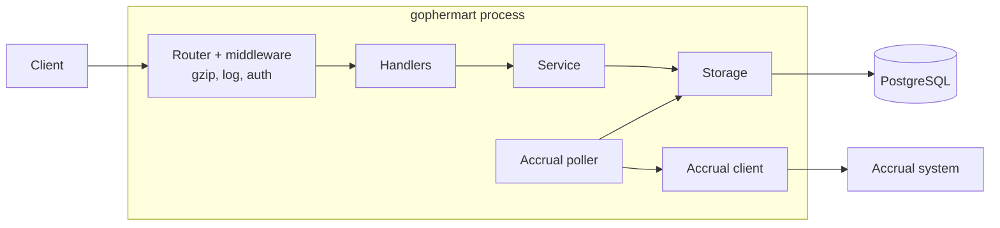

<!-- AI-log: written by an agent (Claude) from the owner's design; the owner made every decision listed here. -->

# Gophermart

Gophermart is a loyalty points account for the buyers of an online shop. A buyer uploads the
numbers of their orders, Gophermart asks the shop's accrual system how many points each order
earned, and the buyer spends the points on later orders. One point is one unit of local
currency.

This is the graduation project of the Yandex Practicum "Go advanced" course. The design is
decided; the code arrives in a stack of pull requests.

Interactive design page, with a step-by-step walk through every request:
[docs/index.html](docs/index.html) (source in the repo), also served at
<https://ilyuha888.github.io/gophermart/> once the docs are merged to `master`.

The order of the code pull requests and what each must pass: [docs/PLAN.md](docs/PLAN.md).

## Who does what

- **Buyer** registers, buys in the shop, hands Gophermart the order number, spends points.
- **Online shop** sells and issues order numbers. Not built here.
- **Accrual system** decides how many points an order earns. It answers slowly and limits how
  often it may be asked. It comes with the course as a binary in `cmd/accrual/`.
- **Gophermart** links order numbers to buyers, polls the accrual system until each order has
  a final answer, keeps the balance and records spending.

Example: a buyer uploads an order and the accrual system credits it 500 points. The buyer
spends 42 on a new order and has 458 left, 42 withdrawn. A request to spend 1000 gets 402: not
enough points.

## Blocks



The accrual poller takes orders that are not final from the database, so the database is the
queue and a restart loses nothing. A worker pool asks the accrual system about them; a 429
answer pauses the whole pool for the `Retry-After` time.

## API

All endpoints except register and login need the auth cookie; without it they answer 401.

| Endpoint | Codes |
|---|---|
| `POST /api/user/register` | 200 registered and logged in, 400 bad request, 409 login taken, 500 |
| `POST /api/user/login` | 200 logged in, 400 bad request, 401 wrong login or password, 500 |
| `POST /api/user/orders` | 202 accepted, 200 already uploaded by this user, 400 bad request, 401, 409 uploaded by another user, 422 bad order number, 500 |
| `GET /api/user/orders` | 200 list, newest first, 204 no orders, 401, 500 |
| `GET /api/user/balance` | 200 `{current, withdrawn}`, 401, 500 |
| `POST /api/user/balance/withdraw` | 200 done, 400 bad JSON or sum ≤ 0 (D12), 401, 402 not enough points, 422 bad or repeated order number, 500 |
| `GET /api/user/withdrawals` | 200 list, newest first, 204 none, 401, 500 |

## Configuration

| Flag | Environment variable | Meaning |
|---|---|---|
| `-a` | `RUN_ADDRESS` | address and port the service listens on |
| `-d` | `DATABASE_URI` | PostgreSQL connection string |
| `-r` | `ACCRUAL_SYSTEM_ADDRESS` | address of the accrual system |
| — | `JWT_SECRET` | key that signs auth tokens; required, the service does not start without it |

## Decisions

- **D1 Layers:** handler → service → storage.
- **D2 Authentication:** JWT in a cookie, valid 24 h, checked by signature only; logout is
  beyond the task.
- **D3 Accrual polling:** the database is the queue; a ticker feeds a worker pool; 429 pauses
  the whole pool.
- **D4 Balance:** computed from sums of accruals and withdrawals; the user row is locked
  during a withdrawal.
- **D5 Money in the database:** `BIGINT` hundredths, so 500.5 points is stored as 50050.
- **D6 Repository:** public `Ilyuha888/gophermart`, from the course template.
- **D7 Password hash:** bcrypt from `golang.org/x/crypto`.
- **D8 Code from metrics-alerting:** ported by hand where needed: logger, gzip, retry, flag
  parsing, goose migrations.
- **D9 CI branch rules:** none; the workflows run on any pull request and on pushes to
  `main`/`master`.
- **D10 Order status mapping:** the accrual system's REGISTERED and PROCESSING become our
  PROCESSING; INVALID and PROCESSED are final.
- **D11 Withdrawal order number:** unique; a repeat gets 422.
- **D12 Withdrawal input:** bad JSON or a sum ≤ 0 gets 400; 422 is only for the order number.
- **D13 Packages:** `internal/handler`, `internal/service`, `internal/storage`,
  `internal/accrual`.
- **D14 JWT secret:** required `JWT_SECRET` env var; CI sets it in the Test step of the
  gophermart workflow, added together with the auth code.

## Updating the template

To receive updates of the autotests and other template parts, add the template remote once:

```sh
git remote add -m master template https://github.com/yandex-praktikum/go-musthave-diploma-tpl.git
```

Then pull the newer autotests and commit the change:

```sh
git fetch template && git checkout template/master .github
```

After an update, check that the Test step in `.github/workflows/gophermart.yml` still sets
`JWT_SECRET` (D14).
